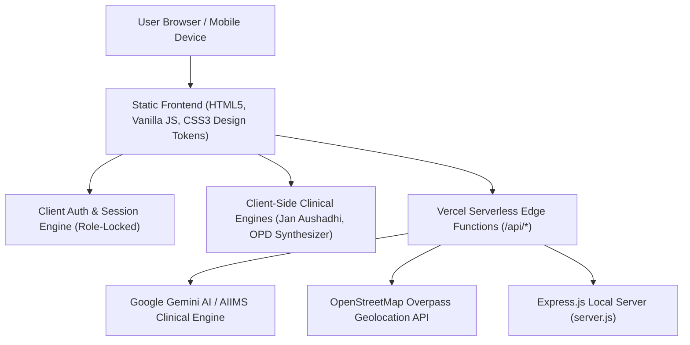

<div align="center">

# 🏥 MediGuide India
### Modern Citizen Healthcare Navigation & Emergency Medical Portal

[](https://mediguide-xi.vercel.app)
[](https://github.com/dakshchawla1/Mediguide)
[](https://mediguide-xi.vercel.app)
[](mailto:daksh22chawla@gmail.com)

<p align="center">
  <a href="https://mediguide-xi.vercel.app"><b>🌐 Launch Live Web App</b></a> •
  <a href="https://mediguide-xi.vercel.app/symptoms.html"><b>🩺 Symptom Triage</b></a> •
  <a href="https://mediguide-xi.vercel.app/medicines.html"><b>💊 Jan Aushadhi Medicines</b></a> •
  <a href="https://mediguide-xi.vercel.app/opd.html"><b>⏰ OPD Schedules</b></a> •
  <a href="https://mediguide-xi.vercel.app/emergency.html"><b>🚨 Emergency SOS 108</b></a>
</p>

---

</div>

<p align="center">
  <b>MediGuide India</b> is a high-speed, accessible digital healthcare portal engineered for Indian citizens. It bridges the gap between emergency triage, OPD counter registration hours, generic drug pricing (Pradhan Mantri Bhartiya Janaushadhi Pariyojana), and hospital discovery across all 28 states and 8 union territories.
</p>

<div align="center">

```
  ┌─────────────────────────────────────────────────────────────────────────────┐
  │   [🩺 Symptoms]  ·  [💊 Medicines]  ·  [⏰ OPD]  ·  [🏥 Hospitals]  ·  [🚨 SOS]  │
  │   Violet #7c3aed    Emerald #059669    Amber #d97706   Azure #0284c7   Crimson #dc2626 │
  └─────────────────────────────────────────────────────────────────────────────┘
```

</div>

---

## 🎨 System Highlights & Color Themes

MediGuide employs a **color-coded clinical visual identity** where every healthcare service has its own distinctive aesthetic and theme palette:

| Feature / Page | Theme Color | Live Route | Core Capability |
| :--- | :---: | :--- | :--- |
| **Home Portal** | 🌈 **Multi-Tone** | [`index.html`](https://mediguide-xi.vercel.app) | Unified healthcare navigation hub with interactive directory |
| **Symptom Triage** | 💜 **Violet `#7c3aed`** | [`symptoms.html`](https://mediguide-xi.vercel.app/symptoms.html) | Dual-tier AIIMS clinical decision logic & Gemini AI reasoning |
| **Jan Aushadhi Medicines** | 💚 **Emerald `#059669`** | [`medicines.html`](https://mediguide-xi.vercel.app/medicines.html) | 70+ drugs, Jan Aushadhi generic equivalents & 65–85% savings |
| **Hospital OPD Timings** | 🧡 **Amber `#d97706`** | [`opd.html`](https://mediguide-xi.vercel.app/opd.html) | 80+ institutions, automatic No-OPD alerts & live registration clocks |
| **Hospital & Map Finder** | 💙 **Azure `#0284c7`** | [`hospitals.html`](https://mediguide-xi.vercel.app/hospitals.html) | Interactive Google Maps, GPS location & apex hospital registry |
| **Emergency Casualty SOS** | ❤️ **Crimson `#dc2626`** | [`emergency.html`](https://mediguide-xi.vercel.app/emergency.html) | 1-click 108/112 dialer, live GPS sharing & CPR first-aid cards |
| **National Helplines** | 🌸 **Rose `#e11d48`** | [`helplines.html`](https://mediguide-xi.vercel.app/helplines.html) | Tele-MANAS, Women, Child, Poison, and Blood Bank directory |
| **Patient / Doctor Portal** | 🔷 **Navy `#2563eb`** | [`login.html`](https://mediguide-xi.vercel.app/login.html) | Role-locked auth, email binding, and custom photo storage |
| **User Profile Dashboard** | 💎 **Cobalt `#1d4ed8`** | [`profile.html`](https://mediguide-xi.vercel.app/profile.html) | Health notes, days active, activity history & account settings |

---

## 🚀 Key Functional Modules

### 1. 🩺 Dual-Tier Clinical Symptom Triage Desk
* **Bilingual Natural Language Input:** Accepts symptom descriptions in plain English or Hindi (e.g., *"severe headache with nausea"*, *"सीने में दर्द और सांस फूलना"*).
* **Tier 1 (Instant AIIMS Protocol Engine):** Human-doctor verified decision matrix that categorizes symptoms by clinical urgency:
  * 🔴 **Immediate (Emergency):** Acute coronary syndrome, stroke, hypoxia, anaphylaxis.
  * 🟠 **High (Within 24 Hours):** Acute febrile illness, severe gastroenteritis, asthma flare.
  * 🟡 **Moderate (Within 48 Hours):** Migraine, recurrent gastritis, musculoskeletal sprains.
* **Tier 2 (Gemini AI Cloud Inference):** Deep diagnostic reasoning providing recommended specialist, diagnostic lab tests to ask, and initial self-care precautions.

### 2. 💊 Jan Aushadhi Generic Medicine Search & Price Comparison
* **National Drug Database:** 70+ everyday pharmaceuticals categorized across analgesics, antibiotics, PPIs, cardiovascular drugs, and diabetes management.
* **Smart Suffix & Salt Classifier:** Automatically identifies pharmacological categories from suffixes (`-statin`, `-sartan`, `-prazole`, `-cillin`, `-mycin`, `-olol`, `-dipine`) and provides:
  * Branded market MRP vs. Jan Aushadhi Kendra price.
  * Calculated price savings (**~65% to 85% savings**).
  * Clinical indications, standard adult dosage guidelines, and common side effects.
  * Schedule H & H1 regulatory prescription warnings.

### 3. ⏰ Universal Hospital OPD Schedules & "No-OPD" Badging
* **80+ Pre-Indexed National Institutions:** Detailed departmental schedules for AIIMS, Safdarjung, RML, PGI Chandigarh, SMS Jaipur, KGMU Lucknow, Tata Memorial, KEM Mumbai, CMC Vellore, Medanta, Apollo, Fortis, Max, Narayana Health.
* **Automatic "No-OPD" Detection:** Dedicated 24/7 trauma centers, emergency casualties, blood banks, or pathology labs display an unmistakable **`🚫 NO ROUTINE OPD`** badge explaining that care is provided strictly on an emergency/diagnostic basis.
* **Universal Clinical OPD Synthesizer:** If a user searches any regional, civil, or private hospital not in the database, the engine generates the standardized Indian operational OPD timetable (distinguishing between Government token windows `08:00 AM – 11:30 AM` vs. Private slots).
* **Live Status Indicator:** Real-time badge computing registration status based on Indian Standard Time.

### 4. 👤 Role-Locked Authentication & Personal Health Profile
* **Permanent Email Role-Lock:** An email registered as a Patient is permanently prevented from logging in as a Clinician and vice-versa, avoiding identity collisions.
* **Real Profile Photo Support:** Upload device photos directly stored as localized base64 avatar images, displayed in top-right nav pills across all pages.
* **Local Health Notes:** Private personal notepad stored safely on device localStorage.

---

## 🏗️ Architecture & Technology Stack



* **Frontend:** Semantic HTML5, CSS3 Variables (theme tokens, zero frameworks for max speed), Vanilla ES6+ JavaScript.
* **Backend:** Node.js, Express.js (v5), Serverless Vercel Edge API Functions (`/api/medicine`, `/api/triage`, `/api/status`, `/api/groq`).
* **AI & Clinical Engine:** Google Gemini AI API + AIIMS Clinical Decision Protocol Fallback Engine.
* **Hosting & CI/CD:** Vercel Production Cloud + GitHub Actions (`.github/workflows/deploy.yml`).

---

## 💻 Local Setup & Development

### 1. Clone & Install
```bash
# Clone the repository
git clone https://github.com/dakshchawla1/Mediguide.git

# Navigate into the project folder
cd Mediguide

# Install runtime dependencies
npm install
```

### 2. Configure Environment (Optional for Live Gemini AI)
Create a `.env` file in the root directory:
```env
PORT=3000
GEMINI_API_KEY=your_gemini_api_key_here
```
*(Note: MediGuide works 100% offline using built-in verified clinical engines even without an API key).*

### 3. Launch Local Server
```bash
npm start
```
Open **`http://localhost:3000`** in your browser.

---

## 📂 Repository File Directory

```text
Mediguide/
├── .github/
│   └── workflows/
│       └── deploy.yml        # Automated GitHub Pages CI/CD workflow
├── api/                      # Serverless Cloud Endpoints (Vercel)
│   ├── groq.js               # LLM inference proxy
│   ├── medicine.js           # Generic drug formulary resolver
│   ├── overpass.js           # OpenStreetMap hospital locator proxy
│   ├── status.js             # Health check & uptime endpoint
│   └── triage.js             # Clinical symptom triage resolver
├── css/
│   └── main.css              # Unified multi-palette clinical design tokens
├── js/
│   └── main.js               # Dark/light theme engine, nav user pill, toasts
├── emergency.html            # 24/7 SOS dialer, GPS broadcast & CPR first aid
├── helplines.html            # Verified national toll-free health directory
├── hospitals.html            # Hospital directory & interactive map locator
├── index.html                # Main portal gateway & service directory
├── login.html                # Role-locked authentication (Patient / Clinician)
├── medicines.html            # Jan Aushadhi generic drug database (70+ drugs)
├── opd.html                  # Universal hospital OPD schedules & No-OPD alerts
├── profile.html              # Personal health dashboard & medical notes
├── server.js                 # Express.js backend & verified clinical triage engine
├── package.json              # Project dependencies & scripts
├── README.md                 # Complete project showcase documentation
└── HOW_TO_RUN.md             # Developer quickstart instructions
```

---

## ⚡ Serverless API Endpoints

| Endpoint | Method | Params / Body | Description |
| :--- | :---: | :--- | :--- |
| `/api/medicine` | `GET` | `?q=paracetamol` | Returns generic composition, Jan Aushadhi pricing, savings %, and dosage |
| `/api/triage` | `POST` | `{"symptom": "fever", "language": "en"}` | Returns triage urgency, specialist recommendation, and clinical advice |
| `/api/status` | `GET` | *None* | Health status and operational uptime metrics |

---

## 👤 Author & Credits

* **Developer:** **Daksh Chawla**
* **Email:** [daksh22chawla@gmail.com](mailto:daksh22chawla@gmail.com)
* **GitHub:** [@dakshchawla1](https://github.com/dakshchawla1)
* **Live Project:** [https://mediguide-xi.vercel.app](https://mediguide-xi.vercel.app)

---

> [!IMPORTANT]
> **Medical Disclaimer:** MediGuide India is an informational healthcare navigation portal. Clinical triage results, Jan Aushadhi pricing comparisons, and OPD timetables are compiled for public guidance. In acute emergencies or severe distress, dial **108** or **112** immediately.

<div align="center">
  <sub>Built with ❤️ for Indian Healthcare Accessibility • MediGuide India © 2026</sub>
</div>
