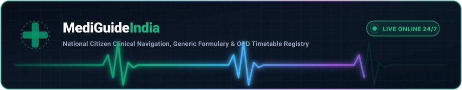
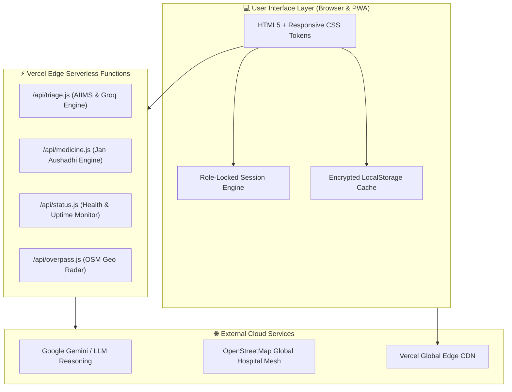

<div align="center">

<!-- Animated Waving Header Banner -->


<!-- Dynamic Animated Typing Text -->
<p align="center">
  <a href="https://mediguide-xi.vercel.app">
    
  </a>
</p>

<!-- Interactive Status & Live Deployment Badges -->
<p align="center">
  <a href="https://mediguide-xi.vercel.app"></a>
  <a href="https://github.com/dakshchawla1/Mediguide"></a>
  <a href="https://mediguide-xi.vercel.app"></a>
  <a href="mailto:daksh22chawla@gmail.com"></a>
</p>

<!-- Live Pulse Heartbeat Animation Banner (Animated SVG) -->
<p align="center">
  
</p>

<!-- Quick Action Navigation Bar -->
<p align="center">
  <a href="https://mediguide-xi.vercel.app"><b>🌐 Launch Portal</b></a> •
  <a href="https://mediguide-xi.vercel.app/symptoms.html"><b>🩺 Symptom Triage</b></a> •
  <a href="https://mediguide-xi.vercel.app/medicines.html"><b>💊 Jan Aushadhi</b></a> •
  <a href="https://mediguide-xi.vercel.app/opd.html"><b>⏰ OPD Schedules</b></a> •
  <a href="https://mediguide-xi.vercel.app/hospitals.html"><b>📍 Hospital Radar</b></a> •
  <a href="https://mediguide-xi.vercel.app/emergency.html"><b>🚨 SOS 108</b></a> •
  <a href="https://mediguide-xi.vercel.app/login.html"><b>🔐 Role Portal</b></a>
</p>

---

</div>

## 🌟 Executive Overview

**MediGuide India** is a modern, high-speed, zero-dependency digital healthcare infrastructure engineered for Indian citizens. It bridges the critical divide between emergency triage, OPD counter registration hours, generic drug pricing (*Pradhan Mantri Bhartiya Janaushadhi Pariyojana*), and hospital discovery across all 28 states and 8 union territories.

Built with a clinical **design-token architecture**, the platform guarantees sub-second navigation, offline resilience via `localStorage`, dual-tier AI reasoning, and strict role-locked authentication.

<br />

```
  ┌─────────────────────────────────────────────────────────────────────────────────────────────┐
  │   [🩺 SYMPTOMS]    [💊 MEDICINES]      [⏰ OPD HOURS]     [🏥 HOSPITALS]    [🚨 EMERGENCY]  │
  │   Violet #7c3aed   Emerald #059669     Amber #d97706      Azure #0284c7     Crimson #dc2626 │
  │   AIIMS Clinical   Jan Aushadhi MRP    Live Clock & AI    GPS Map Radar     SOS 108 / CPR   │
  └─────────────────────────────────────────────────────────────────────────────────────────────┘
```

---

## 🎨 Clinical Design System & Color-Coded Architecture

Each module is deliberately color-coded to provide cognitive clarity during emergency and outpatient scenarios:

| Module / Route | Theme Accent | Live Access | Clinical / Operational Scope |
| :--- | :---: | :--- | :--- |
| **Home Portal** | 🌈 **Multi-Tone** | [`index.html`](https://mediguide-xi.vercel.app) | Central command hub with instant feature cards, quick search, and emergency hotlines |
| **Symptom Triage** | 💜 **Violet `#7c3aed`** | [`symptoms.html`](https://mediguide-xi.vercel.app/symptoms.html) | Dual-tier AIIMS emergency urgency classifier & Gemini diagnostic inference |
| **Jan Aushadhi Medicines** | 💚 **Emerald `#059669`** | [`medicines.html`](https://mediguide-xi.vercel.app/medicines.html) | 70+ generic pharmaceuticals with 65%–85% savings vs. brand MRP |
| **Hospital OPD Timings** | 🧡 **Amber `#d97706`** | [`opd.html`](https://mediguide-xi.vercel.app/opd.html) | 80+ national hospitals, live IST registration countdown clocks & No-OPD alerts |
| **Hospital Radar & Maps** | 💙 **Azure `#0284c7`** | [`hospitals.html`](https://mediguide-xi.vercel.app/hospitals.html) | GPS proximity discovery, Google Maps routing & apex medical college registry |
| **Emergency Casualty SOS** | ❤️ **Crimson `#dc2626`** | [`emergency.html`](https://mediguide-xi.vercel.app/emergency.html) | 1-touch 108/112 auto-dialer, WhatsApp live GPS broadcasting & interactive CPR guides |
| **National Helplines** | 🌸 **Rose `#e11d48`** | [`helplines.html`](https://mediguide-xi.vercel.app/helplines.html) | Tele-MANAS (14416), Women (1091), Childline (1098), Poison control & Blood bank dialers |
| **Role-Locked Auth** | 🔷 **Navy `#2563eb`** | [`login.html`](https://mediguide-xi.vercel.app/login.html) | Enforced email-role binding (patient email cannot access doctor role and vice-versa) |
| **User Profile Dashboard** | 💎 **Cobalt `#1d4ed8`** | [`profile.html`](https://mediguide-xi.vercel.app/profile.html) | Real Google account photo / local camera avatar, private clinical notepad & metrics |

---

## 🚀 Key Innovation Highlights

### 1. 🩺 Dual-Tier Clinical Symptom Triage Desk
* **Bilingual Natural Language Understanding:** Interprets symptoms in colloquial English or Hindi (e.g., *"severe chest pressure radiating to left arm"*, *"सीने में जकड़न और पसीना"*).
* **Tier 1 (Instant AIIMS Protocol Matrix):** Deterministic clinical decision tree flagging life-critical conditions without latency:
  * 🔴 **IMMEDIATE CASUALTY:** Myocardial infarction, acute stroke (FAST protocol), respiratory arrest, severe trauma.
  * 🟠 **HIGH URGENCY (Within 24 Hours):** High febrile illness, acute gastroenteritis with dehydration, asthma exacerbation.
  * 🟡 **MODERATE (Within 48 Hours):** Migraine episodes, acid peptic disorder, non-radiating sprains.
* **Tier 2 (Gemini Cloud Diagnostic Reasoning):** Delivers secondary differential guidance, recommended clinical specialties (e.g. Cardiologist vs. Pulmonologist), suggested preliminary blood panels, and non-pharmacological self-care.

### 2. 💊 Jan Aushadhi Generic Medicine Engine
* **PMBJP Formulary Coverage:** Search across 70+ high-frequency generic salts, from Paracetamol and Metformin to Rosuvastatin and Amoxicillin-Clavulanate.
* **Intelligent Pharmacological Salt Classifier:** Matches salt stems (`-statin`, `-sartan`, `-prazole`, `-cillin`, `-mycin`, `-olol`, `-dipine`) to automatically display:
  * Branded market retail price vs. subsidized Jan Aushadhi price.
  * Direct percentage savings calculation (**up to 85% consumer savings**).
  * Therapeutic indications, standard adult dosage advisories, and Schedule H prescription warnings.

### 3. ⏰ Universal OPD Registration Clock & Automatic "No-OPD" Badging
* **80+ Pre-Indexed Apex & Regional Centers:** Full departmental shifts for AIIMS Delhi, Safdarjung, PGI Chandigarh, SMS Jaipur, KGMU Lucknow, Tata Memorial, CMC Vellore, Medanta, Apollo, Fortis, and Max Healthcare.
* **Smart No-OPD Recognition:** Specialised emergency casualties, 24/7 trauma wards, blood transfusion centers, and standalone testing laboratories display prominent **`🚫 NO ROUTINE OPD`** banners with clear explanations.
* **Universal Clinical Timetable Synthesizer:** When querying any regional civil hospital, primary health center, or private clinic outside the static index, MediGuide dynamically builds the standardized Indian OPD shift matrix.
* **Real-Time Clock Engine:** Automatically detects if registration counters are **OPEN**, **CLOSING SOON**, or **CLOSED** based on Indian Standard Time.

### 4. 👤 Identity Role-Lock & Personalized Health Dashboard
* **Strict Role-Email Isolation:** Prevents identity collisions—if an email is registered as a Patient, the engine permanently locks out unauthorized attempts to log in as a Clinician, and vice-versa.
* **Custom Profile Photography:** Supports live avatar uploads stored as persistent base64 images that dynamically populate top navigation pills across all 9 pages.
* **Private Clinical Notepad:** Stores confidential prescription notes, doctor remarks, and health goals locally in encrypted storage.

---

## 🛠️ Technology Stack & Architecture



<div align="center">
  <br />
  
  <br />
</div>

---

## 📁 Repository Directory Structure

```plaintext
MediGuide/
├── 📄 index.html             # Multi-service citizen homepage & directory
├── 📄 symptoms.html          # Dual-tier symptom triage with AIIMS logic
├── 📄 medicines.html         # Jan Aushadhi generic medicines & price comparator
├── 📄 opd.html               # 80+ Hospital OPD schedules & automatic No-OPD alerts
├── 📄 hospitals.html         # Hospital finder with Google Maps routing
├── 📄 emergency.html         # 108/112 SOS caller, GPS broadcast & CPR cards
├── 📄 helplines.html         # National medical, mental health & child helplines
├── 📄 login.html             # Role-locked authentication system
├── 📄 profile.html           # Patient/doctor health profile & notes
├── 📁 api/                   # Vercel Serverless Functions
│   ├── groq.js               # Cloud LLM proxy handler
│   ├── medicine.js           # Medicine lookup & price query handler
│   ├── overpass.js           # OpenStreetMap proxy for nearby facilities
│   ├── status.js             # API health check endpoint
│   └── triage.js             # Symptom evaluation & clinical decision logic
├── 📁 assets/                # Visual & Animated Assets
│   └── pulse-banner.svg      # Animated neon EKG pulse & heartbeat banner
├── 📄 server.js              # Standalone Node.js / Express development server
├── 📄 package.json           # Node.js project manifest & scripts
└── 📄 vercel.json            # Vercel deployment & routing configuration
```

---

## ⚡ Quick Start & Local Setup

### Prerequisites
* **Node.js** (v18.0 or higher recommended)
* **npm** or **pnpm**
* Modern web browser (Chrome, Edge, Firefox, Safari)

### 1. Clone the Repository
```bash
git clone https://github.com/dakshchawla1/Mediguide.git
cd Mediguide
```

### 2. Install Dependencies
```bash
npm install
```

### 3. Launch Development Server
```bash
npm start
```
The application will launch immediately at **`http://localhost:3000`**.

---

## 🤝 Clinical Advisory & Disclaimer

> [!IMPORTANT]
> **Medical Disclaimer:** MediGuide India is designed for educational, informational, and triage-routing purposes only. It is **not** a replacement for formal clinical diagnosis or emergency intervention. In situations involving acute chest pain, sudden numbness, severe breathing difficulty, or trauma, immediately dial **108** or proceed to the nearest emergency department.

---

## 👨‍💻 Author & Lead Engineer

<div align="center">

**Daksh Chawla**  
Lead Architect & Full Stack Developer  
📬 **Email:** [daksh22chawla@gmail.com](mailto:daksh22chawla@gmail.com)  
🐙 **GitHub:** [@dakshchawla1](https://github.com/dakshchawla1)  
🚀 **Live App:** [mediguide-xi.vercel.app](https://mediguide-xi.vercel.app)

<!-- Animated Waving Footer -->


</div>
